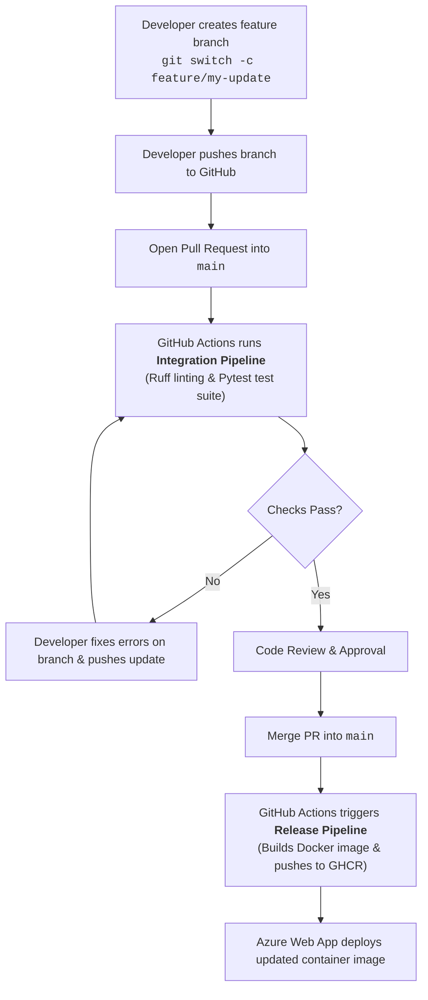

# Classroom CI/CD Demo Guide

This guide walks through the complete end-to-end continuous integration and deployment workflow for classroom demonstration.

---

## 1. Architecture & The PR-Based Workflow

In modern software teams, direct pushes to `main` are restricted. All contributions follow a Pull Request (PR) workflow:



### Key Principles to Explain to Students:
1. **Branch Protection:** No developer pushes directly to `main`.
2. **Shift-Left Quality:** Automated checks (linting, tests, coverage) run in the Integration pipeline before code can be merged.
3. **Traceable Continuous Delivery (CD):** Merging into `main` is the single source of truth that produces release artifacts and triggers deployment.

---

## 2. Local Setup & Verification (Pre-Class Check)

Before presenting, ensure local development and dockerization work:

```powershell
# Run tests and coverage locally
.\.venv\Scripts\python.exe -m pytest --cov

# Run linting check
.\.venv\Scripts\python.exe -m ruff check .

# Build and run the Docker image
docker build -t cicd-demo:latest .
docker run -d --name test-demo -p 8000:8000 cicd-demo:latest

# Verify endpoints
curl http://127.0.0.1:8000/health
curl http://127.0.0.1:8000/docs
curl "http://127.0.0.1:8000/api/quote?subtotal_cents=5000"

# Cleanup
docker rm -f test-demo
```

---

## 3. Live Demonstration Steps (To Show in Class)

### Step A: Demonstrate the PR-Based Workflow & CI Pipeline

1. **Create a feature branch:**
   ```bash
   git switch -c demo/free-shipping-update
   ```
2. **Make a code change:**
   Open `src/cicd_demo/shipping.py` and adjust a parameter or message.
3. **Push the branch & open a Pull Request:**
   ```bash
   git add src/cicd_demo/shipping.py
   git commit -m "feat: adjust shipping logic"
   git push -u origin demo/free-shipping-update
   ```
4. Open the Pull Request on GitHub against `main`.
5. Point students to the **Actions** tab on GitHub:
   - The **Integration Pipeline** triggers automatically.
   - Show the jobs: Ruff linting, formatting check, Pytest execution with code coverage gate (>85%).

---

### Step B: Azure Web App & CD Configuration (Live Setup)

Demonstrate provisioning and configuring the cloud hosting target:

#### 1. Provision Azure Web App
- In Azure Portal, search for **App Services** > click **Create** > **Web App**.
- Configure:
  - **Publish**: Container
  - **Operating System**: Linux
  - **Pricing Plan**: Free (F1) or Basic (B1)
- Click **Review + Create**.

#### 2. Configure Environment Variables
- In the provisioned Web App, navigate to **Settings** > **Environment variables**.
- Click **Add** (App Settings):
  - **Name**: `SCM_DO_BUILD_DURING_DEPLOYMENT`
  - **Value**: `true`
- Click **Apply**.

#### 3. Enable Basic Authentication & Download Publish Profile
- Navigate to **Settings** > **Configuration** (or Deployment settings).
- Ensure **Basic Auth** is enabled for SCM/publishing.
- Go to the Web App **Overview** page.
- Click **Get publish profile** (downloads an XML/text file with deployment credentials).

#### 4. Configure Deployment Center Container Registry
- In the left sidebar, navigate to **Deployment** > **Deployment Center**.
- Under the **Settings** / **Containers** tab, configure:
  - **Registry source**: `Other`
  - **Registry type**: `Private`
  - **Registry login server**: `ghcr.io`
  - **Image and tag**: `<your-github-username>/cicd-test-pipeline:latest`
  - **Username**: Your GitHub username
  - **Password**: GitHub Personal Access Token (classic) with `read:packages` scope
  - **Port**: `8000` (or add App Setting `WEBSITES_PORT=8000`)
- Click **Save**.

#### 5. Add GitHub Repository Secret
- In your GitHub Repository, navigate to:
  **Settings** > **Secrets and variables** > **Actions** > **New repository secret**.
- **Name**: `AZURE_WEBAPP_PUBLISH_PROFILE`
- **Secret**: Paste the full XML content of the downloaded publish profile file.
- *(Optional)* Add repository variable `AZURE_WEBAPP_NAME` set to your Web App's name.

---

### Step C: Trigger CD via PR Merge

1. Return to the open Pull Request on GitHub.
2. Verify all checks from the **Integration Pipeline** are green (Passed).
3. Click **Merge pull request** > **Confirm merge**.
4. Go to the **Actions** tab:
   - Notice that the merge to `main` immediately triggers the **Release Pipeline**.
   - **Job 1 (build-and-push):** Builds the Docker image and publishes it to GitHub Container Registry (`ghcr.io`).
   - **Job 2 (deploy):** Uses the `AZURE_WEBAPP_PUBLISH_PROFILE` secret to trigger Azure Web App to deploy the new container.
5. Open the Azure Web App public URL (`https://<app-name>.azurewebsites.net/`) and show:
   - Home page `/`
   - Health check `/health`
   - Interactive Swagger API docs `/docs`
