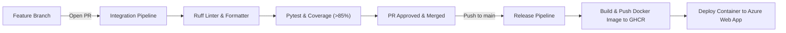

# FastAPI CI/CD Pipeline Workshop

A modern Python FastAPI project demonstrating automated CI/CD using **GitHub Actions**, **Docker**, and **Azure Web App**.

---

## Architecture & Workflow Overview

This project uses a Pull Request (PR) based workflow:
- Direct commits to `main` are restricted.
- Feature branches are developed and proposed via Pull Requests.
- The **Integration Pipeline** automatically triggers on PRs to run linting, code formatting checks, and test coverage gates.
- Merging an approved PR into `main` automatically triggers the **Release Pipeline**, building a production Docker container, publishing it to GitHub Container Registry (`ghcr.io`), and deploying it to Azure Web App.




---

## FastAPI Application Endpoints

The web service is built with **FastAPI** and served using **Uvicorn** on port `8000`:

| Endpoint | Method | Description |
|---|---|---|
| `/` | `GET` | Packaged homepage HTML |
| `/health` | `GET` | Health status and package version (`{"status": "ok", "version": "0.1.0"}`) |
| `/docs` | `GET` | Interactive Swagger API documentation |
| `/api/quote?subtotal_cents=...` | `GET` | Shipping fee calculation rule |

---

## Local Development & Testing

### 1. Install & Test Locally
```powershell
# Create & activate environment
python -m venv .venv
.\.venv\Scripts\Activate.ps1

# Install dependencies
pip install -r requirements.txt -r requirements-dev.txt
pip install -e .

# Run linting
ruff check .
ruff format --check .

# Run test suite with coverage
pytest --cov --cov-report=term-missing
```

### 2. Run with Uvicorn
```powershell
uvicorn cicd_demo.server:app --host 127.0.0.1 --port 8000 --reload
```
Open [http://127.0.0.1:8000/docs](http://127.0.0.1:8000/docs) in your browser.

---

## Docker Container

### Build and Run Locally
```powershell
# Build image
docker build -t cicd-demo:latest .

# Run container
docker run -d --name fastapi-demo -p 8000:8000 cicd-demo:latest

# Verify endpoints
curl http://127.0.0.1:8000/health
curl http://127.0.0.1:8000/docs
curl "http://127.0.0.1:8000/api/quote?subtotal_cents=5000"

# Stop and clean up container
docker rm -f fastapi-demo
```

---

## GitHub Actions Pipelines

The project includes two GitHub Actions pipelines under `.github/workflows/`:

1. **`integration.yml` (CI)**:
   - **Trigger:** On every Pull Request to `main`.
   - **Tasks:** Checks out code, sets up Python 3.13, runs `ruff check`, `ruff format --check`, and executes `pytest` with code coverage reports.
2. **`release.yml` (CD)**:
   - **Trigger:** On every push/merge to `main`.
   - **Tasks:** Builds Docker container image, publishes to GitHub Container Registry (`ghcr.io`), and deploys to Azure Web App using `AZURE_WEBAPP_PUBLISH_PROFILE`.

For step-by-step classroom demonstration instructions, see [CLASSROOM_GUIDE.md](CLASSROOM_GUIDE.md).
